### He builds the things that check an AI before it does something expensive or irreversible.

Founder of reggate. Previously evaluated frontier models for OpenAI on contract, and was Founding GTM & AI Lead at Corgi (YC S24).

<a href="https://reggate.cloud"></a>
<a href="https://github.com/AAdityaisme/spillway"></a>


Currently asking whether intent is why people learn from so little data. The first experiment hasn't run yet.

Also in the drawer: [a website for an artist](https://github.com/AAdityaisme/bela-website) that is better looking than this page.

[LinkedIn](https://www.linkedin.com/in/aadi-sharma-founder) · [Email](mailto:aadityasharma.ca@gmail.com)
